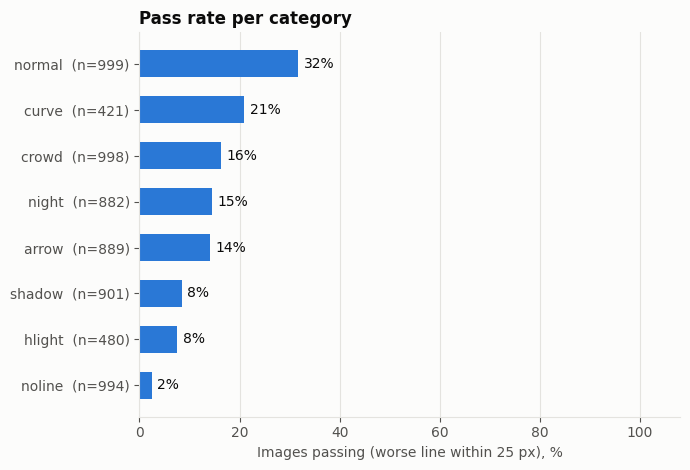
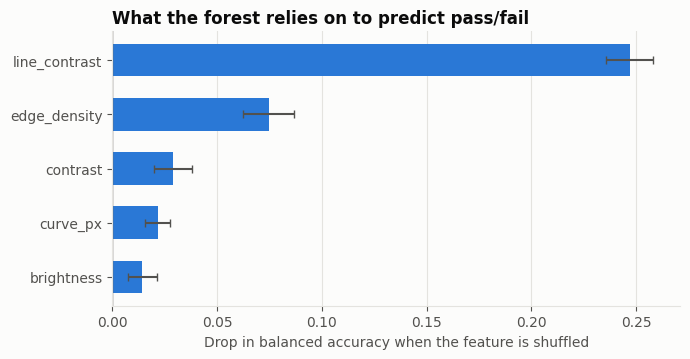
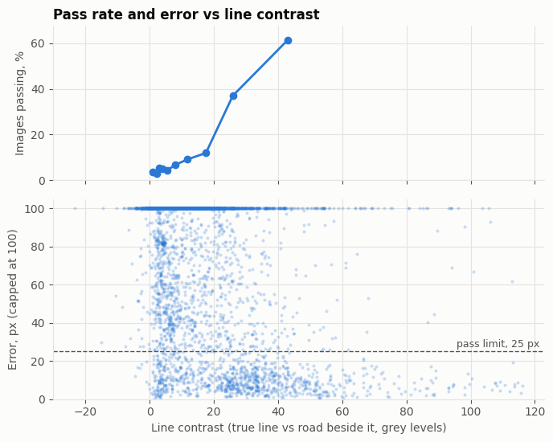
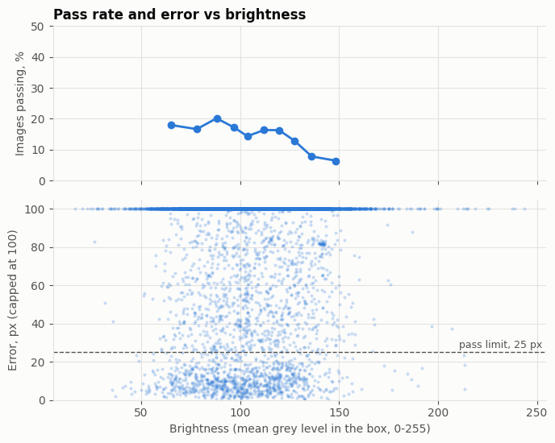
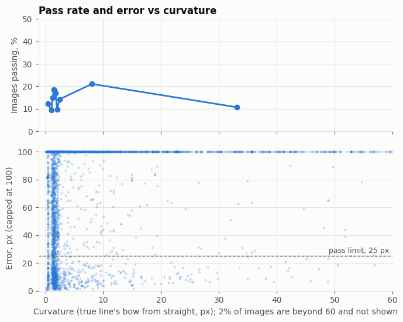
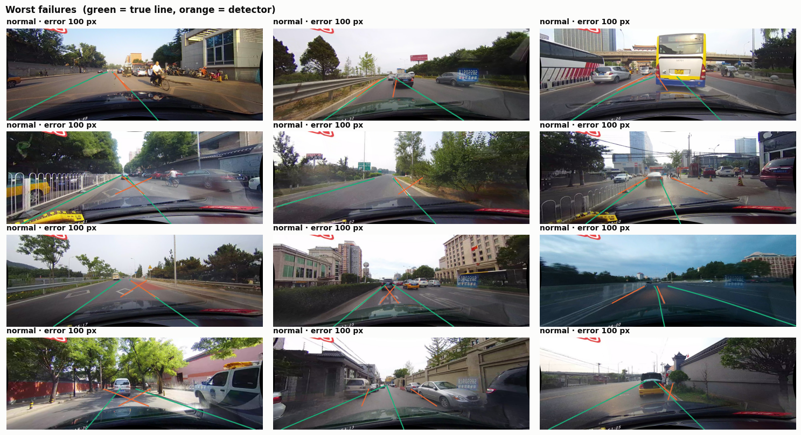

# Where does a classic lane detector fail?

A Canny + Hough lane detector, scored against the CULane benchmark, with a random forest used to explain *why* it fails.

The detector is not the point of this project. The point is the analysis: measuring a simple, classical method on a hard real-world dataset and finding out which properties of a road scene break it.

## Summary

- The detector passes **15%** of 6,564 CULane test images, and **32%** of the "normal" category.
- The main cause of failure is not darkness or curves. It is that **the lane line often cannot be seen**. CULane labels a line even where the paint is worn away, hidden by a car, or was never there.
- Both true lines are clearly visible in only **29%** of images. On those the detector passes **38%**; on the rest it passes **5%**.
- On normal images where both lines are visible, it passes **63%**.
- When the paint *is* visible and it still fails, the usual reason is clutter: the car ahead, road arrows, kerbs and shadows give stronger edges than the lane line.

## Results

### Pass rate per category



An image passes if the worse of its two detected lines is within 25 px of the true line. The "noline" category passes 2%, as expected for a method that can only find paint.

### What explains pass or fail



A random forest was trained to predict pass/fail from five scene features. Line contrast, meaning how much brighter the true line is than the road beside it, matters more than three times as much as any other feature. Edge density comes second, which matches the clutter failures. Brightness matters least.

On held-out images the forest reaches a balanced accuracy of about 81% (chance is 50%). Its plain accuracy, about 85%, is no better than always guessing "fail", because 85% of images fail; balanced accuracy is the fairer number here.

### Line contrast



The pass rate stays under 10% while the line is less than about 15 grey levels brighter than the road, then climbs to about 61% in the highest-contrast tenth of images.

### Brightness



Brightness has a weak effect. The pass rate drifts down from about 18% to about 7% in the brightest tenth of images, where glare washes out the road surface.

### Curvature



No clear trend. Inside the short strip of road the detector looks at, most lanes are close to straight.

### What failure looks like



Green is the true line, orange is the detector's. The detector locks onto the vehicle ahead, diamond markings painted in the lane, and kerbs. In many panels its two lines cross, which real lane lines never do.

## How it works

### The detector

`detect_lanes(image, box)` takes one image and a fixed four-corner box and returns the left and right line of the car's own lane, or `None` for a side where nothing was found.

1. Canny edge detection, masked to the box.
2. Probabilistic Hough transform to find short straight segments.
3. Segments leaning the right way for each side are grouped, and the group nearest the centre is chosen.
4. A straight line is fitted to the edge pixels along that group.

It started as a video lane detector with a hand-clicked region of interest. For this project the windows, clicking and frame-to-frame smoothing were removed so it runs on single images.

### One fixed box per camera

CULane's test images come from three cameras. Each gets one box, used for every image from that camera:

- **Sides:** the typical position of the lane's two lines, taken from the labels and widened by 60%.
- **Bottom:** the top of the car's hood, set by eye per camera. The hood fills roughly the bottom quarter of every image.
- **Top:** 20% of the way down from the point where the lane lines meet.

### Scoring

In the ground-truth labels, the two lanes nearest the middle of the image are the car's own lane. Each detected line is compared with the true one at 8 heights inside the box, and the side's error is the average gap in pixels. A missing line counts as 100 px, and errors are capped at 100 px. The image's error is its worse side.

### Scene features

All five are measured inside the box, from the image and the labels only. Nothing that comes from the detector is used, so the forest cannot simply learn "it failed when it found nothing".

| Feature | Meaning |
|---|---|
| `brightness` | Mean grey level |
| `contrast` | Spread of grey levels |
| `edge_density` | Share of pixels that are Canny edges |
| `curve_px` | How far the true line bows away from a straight line |
| `line_contrast` | How much brighter the true line is than the road beside it, for the fainter of the two lines |

### The model

A scikit-learn random forest (300 trees) predicts pass/fail from the five features, with 25% of images held out. Importance is measured by shuffling one feature at a time on the held-out images and recording the drop in balanced accuracy. The scene category is deliberately left out of the model.

## Running it

1. Create a Kaggle notebook and import `lane_detector_culane_analysis.ipynb`.
2. Add a CULane dataset as input. This project used the `manideep1108/culane` copy.
3. Run all cells. No GPU or internet is needed.

The notebook finds the dataset folders itself, prints how many listed images and labels it found, and saves one row per image to `lane_results.csv`.

### Reproducing the model and charts without the dataset

`analyze_results.py` needs only `lane_results.csv`. It does not run the lane detector or read any images. It prints the summary tables, trains the random forest, and saves the charts to `images/`.

```
pip install pandas scikit-learn matplotlib
python analyze_results.py
```

The worst-failures picture is the one chart it cannot make, because that needs the CULane images and the detector; it comes from the notebook.

## Files

| File | Contents |
|---|---|
| `lane_detector_culane_analysis.ipynb` | The detector, scoring, table, model and charts |
| `analyze_results.py` | Standalone script: the model and charts from `lane_results.csv` alone |
| `lane_results.csv` | One row per image: category, camera, features, error, pass/fail |
| `images/` | The charts shown above |

## Limitations

- **A sample, not the full test set.** Up to 1,000 images were drawn per category, so the overall pass rate does not reflect how common each category is in CULane.
- **The "cross" category is excluded.** Those images have no labelled lanes, so there is nothing to score.
- **This is not CULane's official metric.** The benchmark normally scores all lanes with an overlap measure; this project scores only the car's own lane by pixel distance.
- **The 15 grey-level "visible" threshold is a judgement call,** set from a small sample of images. The trend does not depend on it, but the 29% figure does.
- **The hood line was set by eye** for each of the three cameras.
- **The worst-failures grid shows only "normal" images.** Many images tie at the 100 px cap, and the grid takes the first twelve.

## Next steps

- Reject detections where the left and right lines cross.
- Train a small learned lane detector on CULane and score it with the same notebook, to see which failure categories it fixes.
- Project the detected lane into a bird's-eye grid for path planning with A*.

## Data

CULane: Xingang Pan, Jianping Shi, Ping Luo, Xiaogang Wang and Xiaoou Tang, "Spatial As Deep: Spatial CNN for Traffic Scene Understanding", AAAI 2018.
